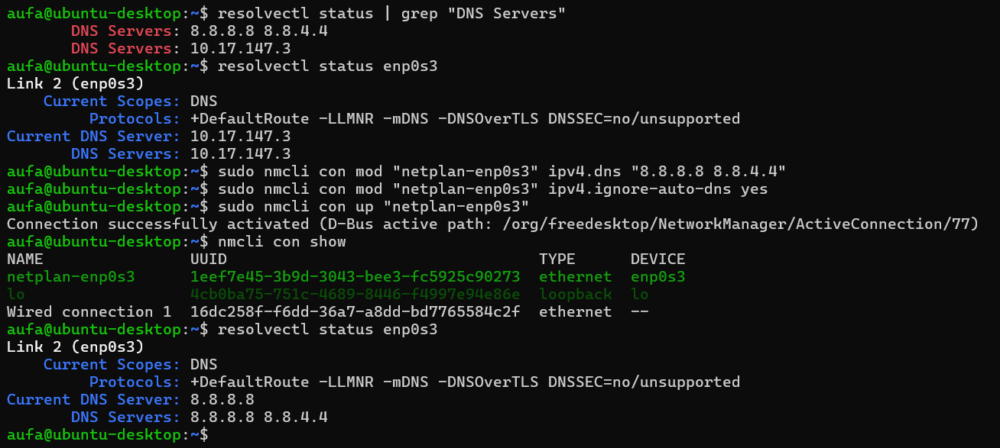

[Index](README.md) | [Fase sebelumnya: 02 API Dasar](02-api-dasar.md) | [Fase berikutnya: 04 Database](04-database.md)

---

# Fase 03: Integrasi Tools Recon

## Masalah

Alur recon yang mau diotomasi: cari subdomain, cek mana yang hidup, scan port di yang hidup, ambil info registrasi domain. Semua dipanggil dari Python lewat `subprocess`.

```
subfinder -> httpx -> nmap
whois (dari domain utama, terpisah)
```

## 3.1 Subfinder

**Pengerjaan**

- Install Go (`apt install golang-go`, versi 1.22.2), lalu `go install` subfinder. Binary-nya ada di `~/go/bin`, jadi aku tambah ke PATH lewat `.bashrc`
- Test manual dulu di terminal sebelum dimasukin ke kode. Subfinder itu passive: dia query database publik (misalnya crt.sh), bukan kirim traffic ke target. Beda dengan gobuster dns yang brute force langsung


**Temuan**

- `example.com` ketemu 23.362 subdomain dalam 3 menit 8 detik. Kebanyakan noise, jadi buat testing aku pakai domain bug bounty yang lebih kecil
- Dari FastAPI hasilnya kosong (`"subdomains": ""`) padahal manual jalan. Penyebab pertama: uvicorn nggak baca `.bashrc`, jadi nggak tau `subfinder` ada di mana. Solusinya pakai path lengkap `/home/aufa/go/bin/subfinder`
- Masih 0 subdomain walau path sudah benar. Setelah dicek, `apt install curl` juga gagal dengan `Temporary failure resolving`. Jadi masalahnya DNS di VM. Setelah DNS diset ke 8.8.8.8, subfinder langsung dapat 10 subdomain hackerone.com dalam 3 detik
- Output subfinder berupa teks yang dipisah newline. Aku ubah jadi list pakai list comprehension supaya string kosong di akhir ikut terbuang:

```python
subdomains = [s for s in result.stdout.split("\n") if s]
```


## 3.2 httpx

**Pengerjaan**

- Install lewat `go install github.com/projectdiscovery/httpx/cmd/httpx@latest` (tanpa `/v2/` di path, beda dengan subfinder). Versi 1.9.0
- Test manual: kirim 3 subdomain lewat pipe. Pertama nggak ada output karena `echo` tanpa `-e` nggak ngartiin `\n`. Pakai `echo -e` baru keluar hasilnya, dan httpx otomatis nambah `https://` atau `http://`

```bash
echo -e "api.hackerone.com\ndocs.hackerone.com\nwww.hackerone.com" | httpx -silent
```


- Di Python, input ke httpx dikirim lewat parameter `input=` (stdin), jadi nggak perlu `echo`. List subdomain digabung jadi satu string dengan newline sebagai pemisah:

```python
httpx_result = subprocess.run(
    ["/home/aufa/go/bin/httpx", "-silent"],
    input="\n".join(subdomains),
    capture_output=True,
    text=True,
)
```

**Temuan**

- Hackerone.com: 19 subdomain, 10 live host. Subfinder dan httpx kebukti jalan bareng dari satu endpoint


## 3.3 Nmap

**Pengerjaan**

- Install lewat apt (versi 7.94). Test manual ke localhost VM dulu pakai `-sC -sV`, ketemu SSH dan CUPS
- Beda dengan httpx, nmap nggak baca target dari stdin. Target harus jadi argumen, jadi list flag digabung dengan list host pakai `+`
- Prefix `http://` dan `https://` dibuang pakai `removeprefix` karena nmap butuh hostname. Host dibatasi 10 pertama (`[:10]`) supaya scan nggak kelamaan

```python
live_hosts_clean = [
    h.removeprefix("https://").removeprefix("http://") for h in live_hosts
][:10]
nmap = subprocess.run(
    ["nmap", "--open", "-F"] + live_hosts_clean,
    capture_output=True,
    text=True,
)
```


**Masalah nmap lambat (muncul pas testing dari frontend)**

- Scan dari frontend nggak selesai-selesai, di terminal uvicorn cuma muncul sampai tahap nmap. Hasil scan baru keluar setelah aku Ctrl+C, dan di UI port-nya kosong semua
- Aku coba isolasi satu per satu di terminal. Setelah DNS diset 8.8.8.8 permanen, nmap tanpa `-sV` selesai 2,5 detik untuk 1 host. Tapi `-sV` jalan 67 detik dan host-nya kena skip karena `--host-timeout 60s`, sedangkan `-sC -sV` 5 menit lebih tanpa hasil
- Aku simpulkan `-sV` dan `-sC` kelamaan di VM yang jaringannya NAT VirtualBox, jadi dilepas. Ini sebabnya hasil nmap di tool ini cuma daftar port open tanpa versi service

Bukti DNS permanen (dipakai di fase ini):



[BUTUH SCREENSHOT: perbandingan waktu nmap `-sV` vs tanpa `-sV`, tambahkan manual kalau masih ada]

## 3.4 Whois

**Pengerjaan**

- Install lewat apt. Whois cuma butuh domain utama dan nerima target sebagai argumen, jadi `["whois", body.domain]`. Subdomain nggak punya registrasi sendiri, makanya nggak di-whois satu-satu


## Temuan

- `subprocess.run` dengan list (bukan string) bikin tiap argumen berdiri sendiri, jadi lebih aman dari command injection dibanding string yang lewat shell
- Tiap tool punya cara nerima input beda: httpx lewat stdin, nmap dan whois lewat argumen. Ini yang awalnya bikin aku bingung
- Tesla.com ketemu sekitar 917 subdomain dan 195 live host, jadi pembatasan nmap ke 10 host memang perlu

## Kesimpulan

Keempat tools sudah tersambung dalam satu endpoint `/scan`. Kompromi yang aku ambil: nmap tanpa deteksi versi supaya scan realistis dijalankan di VM lab.

---

[Index](README.md) | [Fase sebelumnya: 02 API Dasar](02-api-dasar.md) | [Fase berikutnya: 04 Database](04-database.md)
