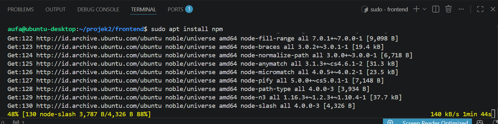
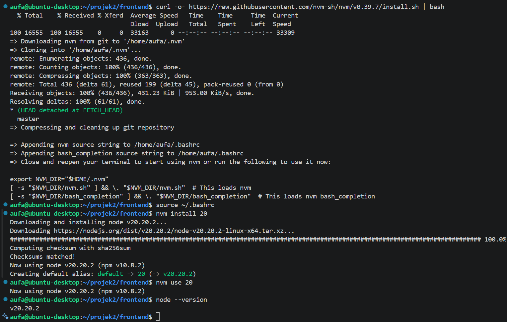
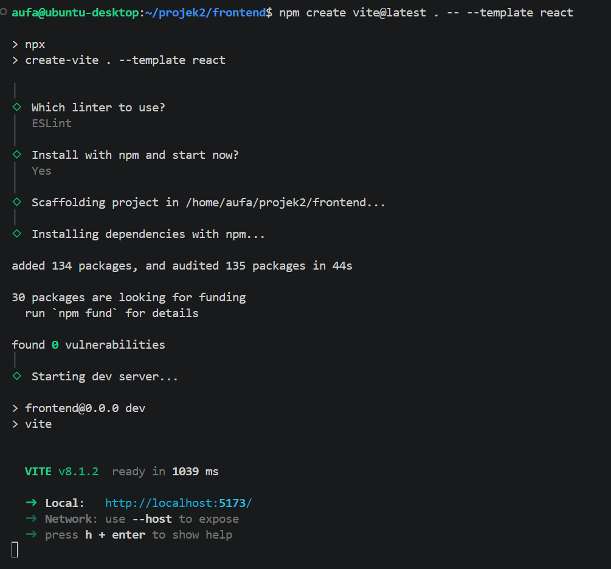
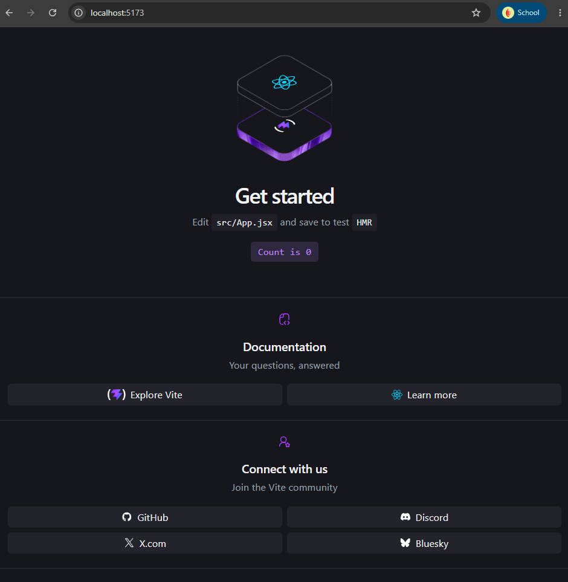
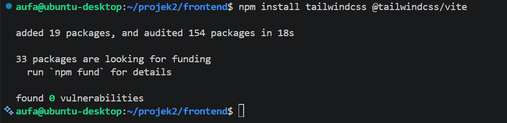
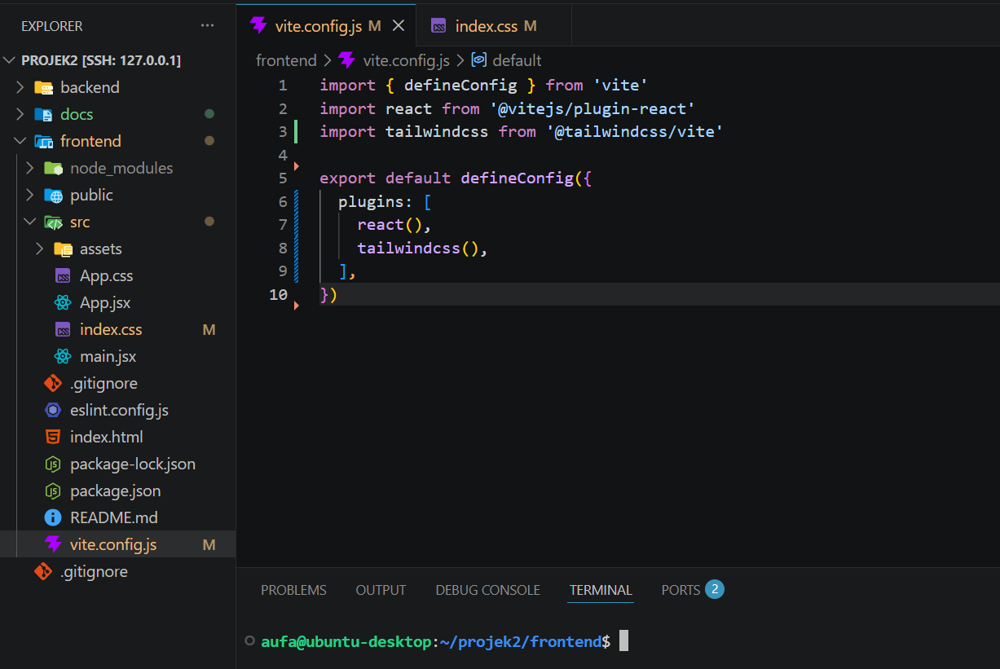
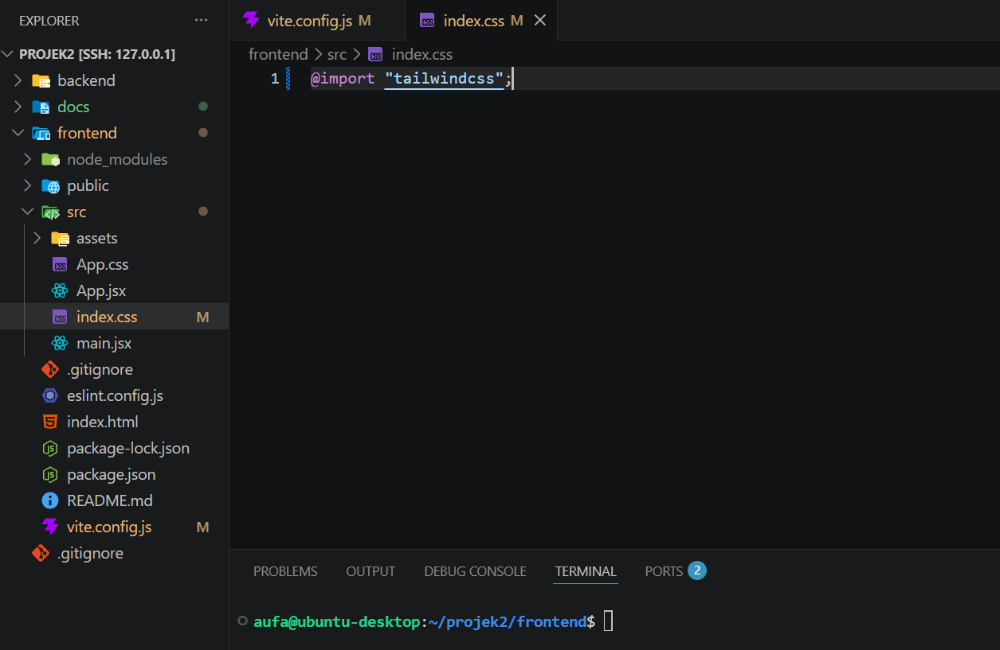
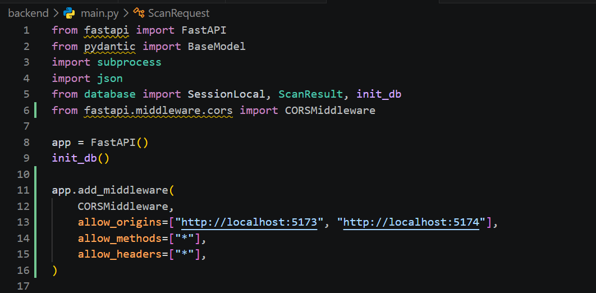
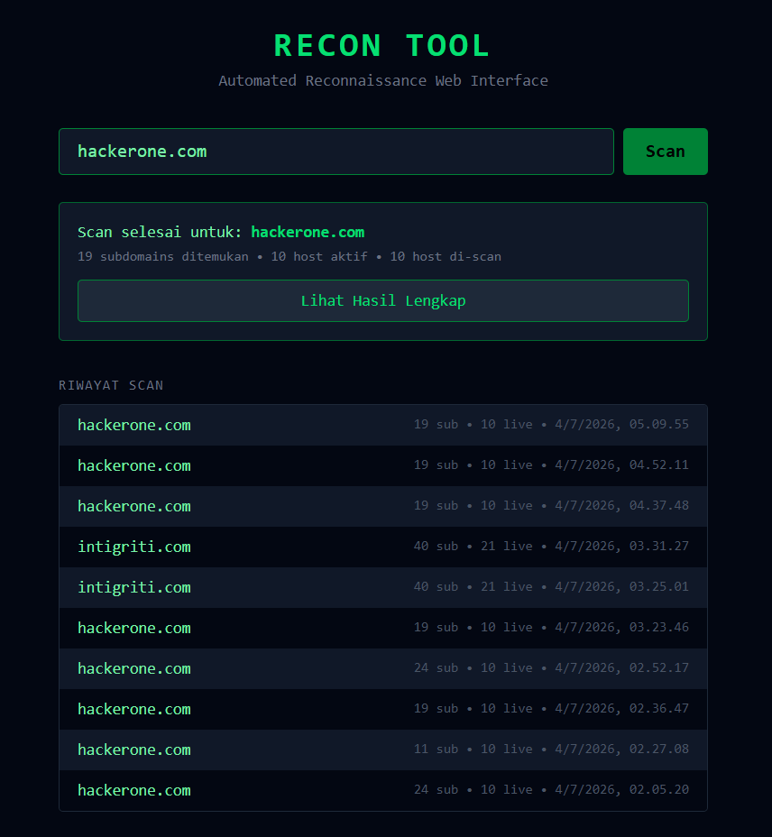
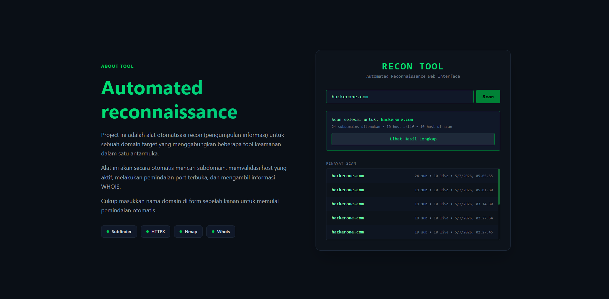

[Index](README.md) | [Fase sebelumnya: 04 Database](04-database.md) | [Fase berikutnya: 06 Keamanan](06-keamanan.md)

---

# Fase 05: Frontend

## Masalah

Backend sudah jalan, tapi tujuan project ini kan supaya recon bisa dipakai tanpa buka terminal. Aku butuh web UI: form input domain, tombol scan, dan tampilan hasil yang enak dibaca.

## Pengerjaan

- Install npm, lalu init project React pakai Vite
- Tailwind dipasang lewat plugin `@tailwindcss/vite` dan `@import "tailwindcss"` di `index.css`
- Komponen utama: form domain, loading state (tombol berubah jadi "Scanning..." dan disabled), kartu ringkasan hasil, modal hasil dengan 4 tab (Subdomains, Live Hosts, Nmap, Domain Info), dan riwayat scan dari `/history`
- Perbaikan UX setelah dicoba: ukuran modal dibuat fixed, live hosts dipisah HTTPS dan HTTP, nmap jadi card per host yang kalau diklik muncul popup detail port, WHOIS diringkas jadi info penting saja, plus animasi fade-in
- Layout akhir dua kolom: kiri penjelasan tool, kanan form scan dan hasil. Bagian layout ini aku bikin sendiri















## Temuan dan Masalah

**Node terlalu lama.** `npm create vite` gagal dengan `SyntaxError: ... does not provide an export named 'styleText'`. Di baris warning ada `required: node ^20.19.0 || >=22.12.0`, sedangkan VM-ku Node v18. Script nodesource ikut gagal, jadi aku pakai nvm dan install Node 20.

**CORS.** Frontend di port 5173 dan backend di port 8000 dianggap origin berbeda. Di terminal uvicorn muncul `OPTIONS /scan ... 405 Method Not Allowed`, itu preflight request dari browser. Solusinya `CORSMiddleware` di FastAPI dengan daftar origin yang diizinkan. Sempat ada masalah lagi karena `localhost` dan `127.0.0.1` dianggap beda, jadi dua-duanya aku masukin.

```python
app.add_middleware(
    CORSMiddleware,
    allow_origins=[
        "http://localhost:5173",
        "http://localhost:5174",
        "http://127.0.0.1:5173",
        "http://127.0.0.1:5174",
    ],
    allow_methods=["*"],
    allow_headers=["*"],
)
```



**Nama key JSON beda.** Scan sukses tapi tab live hosts, nmap, dan whois kosong. Backend sempat return key `"live hosts"` dan `"domain information"` (pakai spasi), sedangkan frontend baca `live_hosts` dan `whois_result`. Setelah key backend disamain pakai underscore, semuanya muncul.

**Scan lama.** Scan sinkron, jadi request nunggu sampai semua tool selesai. Ini yang bikin browser kelihatan "ngegantung" saat nmap lambat (lihat catatan nmap di fase 03).





## Kesimpulan

Tool sudah bisa dipakai penuh dari browser: input domain, scan, lihat hasil per kategori, dan buka riwayat. Dari fase ini aku belajar baca error dari paling bawah, dan bedain error CORS (browser menolak) dengan error backend.

---

[Index](README.md) | [Fase sebelumnya: 04 Database](04-database.md) | [Fase berikutnya: 06 Keamanan](06-keamanan.md)
