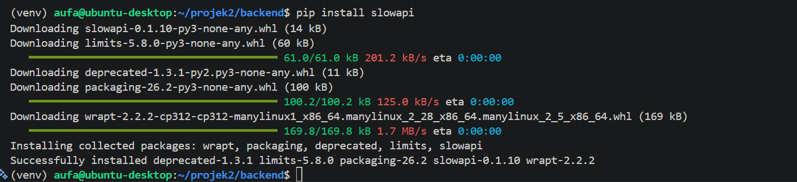
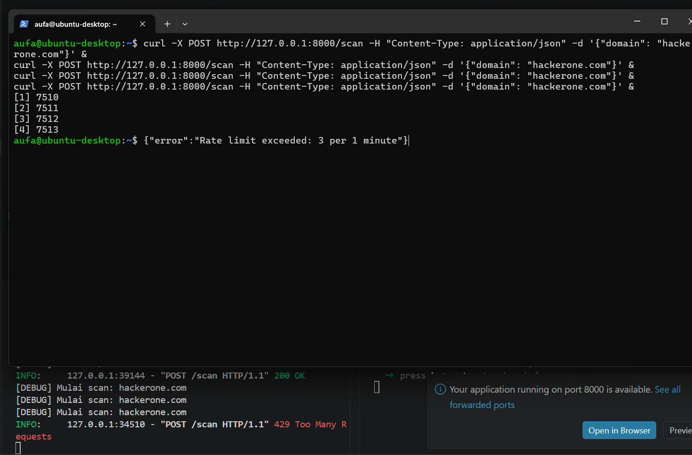

[Index](README.md) | [Fase sebelumnya: 05 Frontend](05-frontend.md)

---

# Fase 06: Input Validation dan Rate Limiting

## Masalah

Domain dari user langsung dilempar ke subprocess (subfinder, nmap, whois). Kalau input nggak dicek, orang bisa kirim sesuatu seperti `google.com; cat /etc/passwd` atau `; rm -rf /`. Itu command injection. Selain itu endpoint `/scan` berat, jadi gampang disalahgunakan kalau bisa di-spam.

## 6.1 Input Validation

**Pengerjaan**

- `subprocess.run` dari awal sudah pakai list, bukan string shell, jadi karakter seperti `;` nggak dieksekusi sebagai perintah baru. Tapi validasi tetap perlu sebagai lapisan kedua
- Validasi dilakukan di class `ScanRequest` pakai `field_validator` Pydantic: domain di-`strip()` dan `lower()`, dicocokkan dengan regex (huruf, angka, titik, strip), dan panjangnya maksimal 253 karakter. Kalau nggak cocok, `raise ValueError` dan FastAPI balas 422

```python
class ScanRequest(BaseModel):
    domain: str

    @field_validator("domain")
    @classmethod
    def validate_domain(cls, v):
        v = v.strip().lower()
        pattern = r"^[a-zA-Z0-9]([a-zA-Z0-9\-]{0,61}[a-zA-Z0-9])?(\.[a-zA-Z0-9]([a-zA-Z0-9\-]{0,61}[a-zA-Z0-9])?)*$"
        if not re.match(pattern, v):
            raise ValueError("Format domain tidak valid")
        if len(v) > 253:
            raise ValueError("Domain terlalu panjang")
        return v
```

**Temuan**

- Ada typo `re.macth` yang ketauan waktu aku baca ulang kodenya, sudah diperbaiki jadi `re.match`
- `raise` dipakai, bukan `print`, karena `raise` menghentikan proses dan memberi tahu FastAPI ada input yang ditolak
- Penjelasan regex lebih detail akan aku tulis terpisah

[BELUM DIUJI: kirim domain tidak valid (misal `google;com`) lalu pastikan balasannya 422. Tambahkan screenshot manual setelah dites]

## 6.2 Rate Limiting

**Pengerjaan**

- Install `slowapi` di dalam venv
- Setup limiter berdasarkan IP, daftarkan ke `app.state`, dan tambahkan handler untuk error `RateLimitExceeded`
- Decorator `@limiter.limit("3/minute")` di endpoint `/scan`. Parameter fungsi diubah jadi `request: Request, body: ScanRequest`, karena slowapi butuh objek `Request` untuk baca IP, sedangkan data JSON pindah ke `body`

```python
limiter = Limiter(key_func=get_remote_address)
app.state.limiter = limiter
app.add_exception_handler(RateLimitExceeded, _rate_limit_exceeded_handler)

@app.post("/scan")
@limiter.limit("3/minute")
def scan_domain(request: Request, body: ScanRequest):
    ...
```

- Frontend ikut diupdate: kalau response 429 atau 422, muncul alert yang jelas, bukan loading terus



**Pengujian**

Tombol Scan di UI disabled saat scanning dan Swagger juga cuma bisa execute satu per satu, jadi limit nggak bisa dites dari situ. Aku tes pakai curl, 4 request sekaligus di background (`&`). Request ke-4 kena `429 Too Many Requests` dengan pesan `Rate limit exceeded: 3 per 1 minute`.



## Temuan

- Rate limit melindungi dari yang bypass UI (curl atau script), sedangkan tombol disabled cuma lapisan pertama
- Limit berlaku per IP, bukan global, karena `key_func=get_remote_address`

## Kesimpulan

Dua kontrol dasar sudah terpasang: validasi input dan rate limiting. Dua-duanya relevan buat tool yang menjalankan perintah sistem dari input user.

---

[Index](README.md) | [Fase sebelumnya: 05 Frontend](05-frontend.md)
